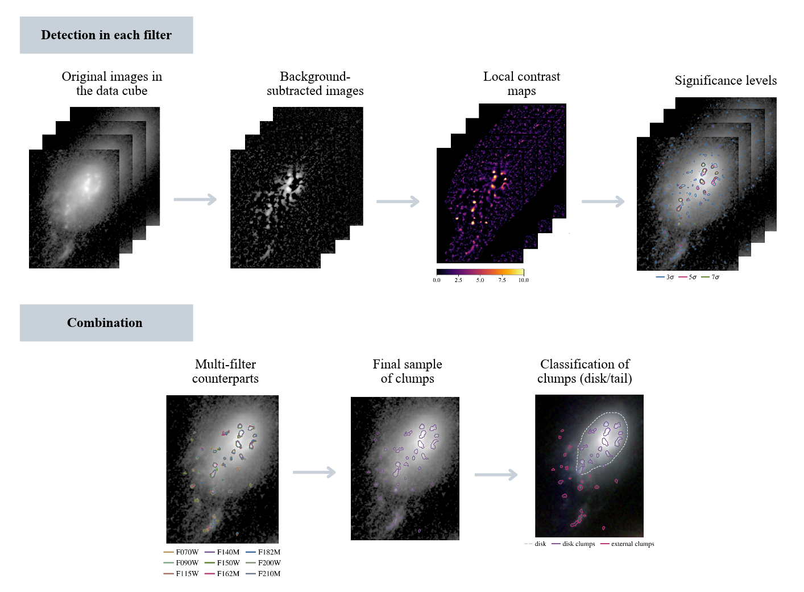

Workflow
========

This page describes the steps of the FOLKLORE algorithm and the functions
that implement them. The ``examples/`` folder of the repository has
complete scripts that run the two stages below over a list of galaxies.

   Detection in each filter (local contrast and significance levels) and
   combination of the filters into the final, classified clump sample.

.. code-block:: text

   DETECTION (PSF-matched detection cube)
   ──────────────────────────────────────
   load_datacube ─► collapse_cube ─► build_galaxy_masks
                                          │
             ┌────────────────────────────┘
             ▼            for each filter
   build_contrast_map ─► select_candidate_pixels ─► refine_hierarchical
             │
             ▼
   build_clump_dataframes ─► compute_clump_overlaps ─► build_overlap_graph
                                                           │
             ┌─────────────────────────────────────────────┘
             ▼
   find_final_clumps ─► build_union_masks ─► compute_clump_geometry
             ─► add_physical_sizes ─► classify_clumps ─► CSV / GeoJSON

   PHOTOMETRY (any cube with WCS: HST, JWST, ...)
   ──────────────────────────────────────────────
   reproject_clump_masks_sky ─► build_background_rings
             ─► compute_clump_photometry ─► sed_fitting_dataframe

1. Galaxy masks
---------------

*Module:* :mod:`folklore.galaxy`

The cube is collapsed along the filter axis (median by default,
:func:`~folklore.galaxy.collapse_cube`) and smoothed with a Gaussian.
:func:`~folklore.galaxy.build_galaxy_masks` thresholds the smoothed image at
a set of percentiles, followed by morphological closing and opening.

* The mask of the **lowest** percentile is the region where clumps are
  searched for.
* The mask of the **highest** percentile is the **central region**, where
  a different detection threshold is used (the bright bulge produces strong
  contrast that is not a clump).

Diagnostics: :func:`~folklore.plotting.plot_galaxy_masks`,
:func:`~folklore.plotting.plot_masks_filters`.

2. Local contrast map
---------------------

*Module:* :mod:`folklore.detection`

For each filter, :func:`~folklore.detection.build_contrast_map` computes

.. math::

   C = \frac{I - B}{\sigma_\mathrm{local}}, \qquad
   B = \mathrm{median}_{\mathrm{bkg\_size}}(I), \qquad
   \sigma_\mathrm{local} = \sqrt{\mathrm{median}_{\mathrm{sigma\_size}}\left[(I - B)^2\right]}

where the medians are running median filters of the given window size.
:math:`C` is the significance of each pixel above its local surroundings,
so compact knots stand out regardless of the underlying disk brightness.
An optional Gaussian smoothing (``sigma_smooth``) can be applied first.

Diagnostics: :func:`~folklore.plotting.plot_contrast_steps`,
:func:`~folklore.plotting.plot_contrast_levels` and
:func:`~folklore.plotting.plot_contrast_levels_filters` (useful to choose
the thresholds).

3. Per-filter detection
-----------------------

*Module:* :mod:`folklore.detection`

* :func:`~folklore.detection.select_candidate_pixels` keeps pixels with
  :math:`C >` ``sigma_center`` inside the central region and
  :math:`C >` ``sigma_outer`` elsewhere in the galaxy mask.
* :func:`~folklore.detection.refine_hierarchical` labels the connected
  regions. If ``sigma_split`` is given, each region is re-thresholded at
  that level and split when it contains two or more separate peaks.
* :func:`~folklore.detection.build_clump_dataframes` drops regions smaller
  than ``min_area`` pixels and returns, per filter, a clump table and a
  pixel table.

Diagnostics: :func:`~folklore.plotting.plot_candidate_pixels`,
:func:`~folklore.plotting.plot_clumps_filters`.

4. Cross-filter matching
------------------------

*Module:* :mod:`folklore.matching`

Detections in different filters are linked when their pixel sets overlap
by at least ``min_overlap`` (by default, overlap relative to the smaller
clump, :func:`~folklore.matching.overlap_fraction`). Links form a graph
(:func:`~folklore.matching.build_overlap_graph`); each connected component
is a candidate physical clump, kept only if it is detected in at least
``min_filters`` distinct filters
(:func:`~folklore.matching.find_final_clumps`).

The final mask of each clump is the union of its pixels in all filters
(:func:`~folklore.matching.build_union_masks`). A subset of filters can be
used for matching by filtering ``pixels_all_filters`` before building the
pixel sets.

Diagnostics: :func:`~folklore.plotting.plot_final_clumps`,
:func:`~folklore.plotting.plot_union_clumps`.

5. Clump properties and classification
--------------------------------------

*Module:* :mod:`folklore.properties`

* :func:`~folklore.properties.compute_clump_geometry`: area, effective
  radius :math:`r_\mathrm{eff} = \sqrt{A/\pi}`, centroid, and the RA/Dec of
  every clump pixel.
* :func:`~folklore.properties.add_physical_sizes`: area and radius in kpc
  for a given redshift and cosmology.
* :func:`~folklore.galaxy.build_galaxy_region` grows the galaxy body from
  its centre by lowering an intensity threshold on the collapsed cube, giving
  one mask per threshold level. By default the level is chosen by eye with
  :func:`~folklore.plotting.plot_galaxy_region_levels` (e.g.
  ``region["masks"][-2]``); optionally it can be chosen automatically, with
  a threshold relative to the peak (``min_fraction``) and a stop when the
  area jumps (``growth_factor``).
* :func:`~folklore.properties.classify_clumps` labels each clump ``disk``
  (centroid inside that region) or ``outside``.

This step needs, for each galaxy, the **coordinates of its centre** (RA,
Dec) and its **redshift**.

Diagnostics: :func:`~folklore.plotting.plot_galaxy_region_levels`,
:func:`~folklore.plotting.plot_classify_clumps`.

6. Outputs
----------

*Module:* :mod:`folklore.polygons`

* ``*_properties.csv``: one row per clump (output of the steps above).
* ``*_pixels.csv``: one row per clump pixel, with ``x, y, ra, dec``. This
  is the file that carries the clump definition to the photometry stage.
* GeoJSON polygons in pixel
  (:func:`~folklore.polygons.build_clump_geodataframe`) and sky
  coordinates (:func:`~folklore.polygons.build_clump_geodataframe_sky`).

7. Photometry
-------------

*Module:* :mod:`folklore.photometry`

Because clumps are stored in sky coordinates, they can be measured on any
cube, even with a different pixel grid:

* :func:`~folklore.photometry.reproject_clump_masks_sky` places each clump
  pixel on the nearest pixel of the new grid.
* :func:`~folklore.photometry.build_background_rings` builds a ring around
  each clump (between two dilation radii, excluding other clumps).
* :func:`~folklore.photometry.compute_clump_photometry` sums the flux in
  the mask, subtracts ``median(ring) × n_pix`` and estimates the error as
  ``std(ring) × sqrt(n_pix)``; fluxes are returned in Jy.
* :func:`~folklore.photometry.sed_fitting_dataframe` turns the long table
  into one row per clump with one flux and one error column per filter,
  ready for SED fitting.

Per-clump cutout cubes (e.g. for spatially resolved SED fitting) can be
written with :func:`~folklore.photometry.build_expanded_clump_masks` and
:func:`~folklore.io.save_individual_clump_cubes`.

Diagnostics: :func:`~folklore.plotting.plot_clump_rings`,
:func:`~folklore.plotting.plot_expanded_clumps`.

Plot options
------------

Every ``plot_*`` function accepts ``norm``, ``norm_kwargs``, ``show``,
``save``, ``output_path`` and ``dpi``; see :mod:`folklore.plotting`. In
scripts, use ``show=False, save=True`` to write the diagnostics to disk.
